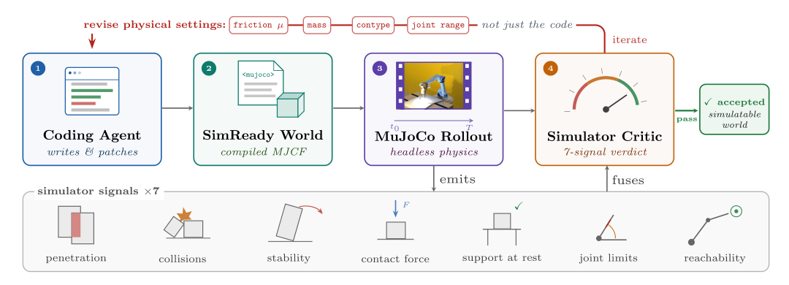
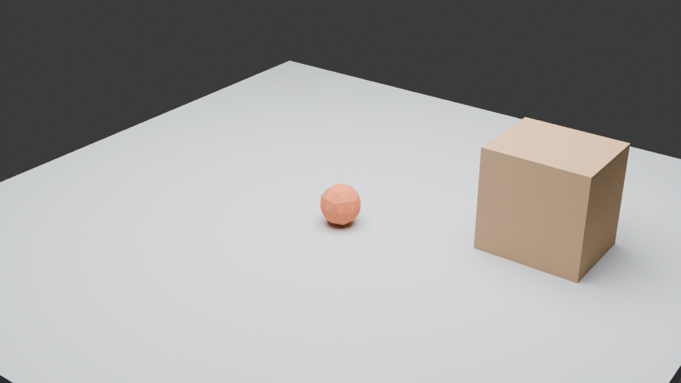
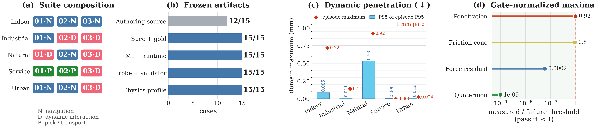

# Code2Worlds-2

**Physically Plausible Agent Harness for Embodied World Simulation**

Code2Worlds-2 extends [Code2Worlds](https://github.com/AIGeeksGroup/Code2Worlds) with two stages that turn a generated Blender scene into an executable MuJoCo world. **Module 1** compiles visual geometry into a SimReady scene with collision meshes, physical attributes, support relations, and MJCF. **Module 2** adds executable rigid and articulated dynamics, runs the scene in MuJoCo, and evaluates simulator signals. The repository also contains the **SimCode4D DEV15** benchmark: 15 state-based tasks across indoor, industrial, natural, service, and urban domains.

> This repository accompanies the submitted TPAMI manuscript *Code2Worlds-2: Physically Plausible Agent Harness for Embodied World Simulation*. Benchmark reference-package checks and generated-method scores are different evaluations; see [Benchmark](#benchmark).



## Paper-to-code map

| Manuscript component | Public code | Output |
| --- | --- | --- |
| Original dual-stream generation and post-process agent | [`third_party/Code2Worlds/`](third_party/Code2Worlds/) | Blender scene and visual dynamics |
| Sec. 3.1: SimReady Scene Compiler | [`module1/`](module1/) | `scene_default.xml`, `scene_enriched.xml`, collision assets |
| Sec. 3.2: Simulator-in-the-Loop 4D Refiner | [`module2/`](module2/) | Executable MJCF, rollout log, simulator-critic verdict |
| Sec. 4: SimCode4D | [`benchmark/simcode4d_unified/`](benchmark/simcode4d_unified/) | Frozen case contracts, probes, validators, metrics |

The detailed [architecture and paper-to-code map](ARCHITECTURE.md) describes
which parts run from this checkout and which require separate authoring inputs.

The original Code2Worlds source is included directly, with its upstream commit recorded in [`third_party/Code2Worlds/UPSTREAM.md`](third_party/Code2Worlds/UPSTREAM.md). Infinigen is a separate dependency and is installed from its own repository.

## Quick start: run Module 1 and Module 2

The checked-in [`demo_scene/scene.blend`](demo_scene/scene.blend) is a small, editable Blender input with a floor, cabinet, and ball. Its [`dynamics_program.json`](demo_scene/dynamics_program.json) specifies a Go2/ball interaction. The public benchmark contains the Go2 model used by this example, so no separate robot download or API key is needed for this offline physics run.



Install Blender 4.0 or newer on your `PATH` and Python 3.10, then run:

```bash
git clone https://github.com/AIGeeksGroup/Code2Worlds-2.git
cd Code2Worlds-2
python -m venv .venv
source .venv/bin/activate
python -m pip install -r requirements-method.txt
python demo_scene/run_demo.py --output /tmp/code2worlds2-demo
```

The command exports the `.blend`, runs key-object selection, support analysis, convex decomposition, offline material estimation, and Module 1 MJCF compilation. It then compiles the dynamic Module 2 world, runs a physics-only MuJoCo rollout, and writes the simulator critic's report. Inspect `/tmp/code2worlds2-demo/module1/scene_enriched.xml`, `/tmp/code2worlds2-demo/module2/scene_m2.xml`, and `/tmp/code2worlds2-demo/module2/critic_report.json`. The script verifies that all three generated MJCF models load. A critic rejection is a diagnostic result, not a failed installation; this tiny example is for exercising the public pipeline, not reproducing a paper score. See the [demo guide](demo_scene/README.md) for the individual commands and how to adapt the scene.

## Quick start: run the benchmark

The benchmark's 15 frozen runtime packages, contracts, probes, validators, and required simulator assets are included. Python 3.10 is recommended; the paper used Python 3.10.8, MuJoCo 3.9.0, and NumPy 1.26.3.

```bash
git clone https://github.com/AIGeeksGroup/Code2Worlds-2.git
cd Code2Worlds-2
python -m venv .venv
source .venv/bin/activate
python -m pip install -r requirements-benchmark.txt
python benchmark/simcode4d_unified/check_public_release.py

# One case and one physics seed; write results outside the checkout.
python benchmark/simcode4d_unified/tools/run_matrix.py \
  --suite benchmark/simcode4d_unified \
  --output /tmp/simcode4d-smoke \
  --case-ids SER-03-hotel-drawer \
  --generation-seeds 1103 \
  --physics-seeds 401 \
  --skip-preflight
```

The public integrity check verifies the included hash-bound artifacts and loads all 15 MuJoCo models. `--skip-preflight` skips the original archive preflight, which also requires the omitted multi-gigabyte Blender authoring scenes; the runner still checks registered toolchain, case, and runtime hashes. Three case packages were [rebound to relative mesh paths](benchmark/simcode4d_unified/PORTABILITY.md) for this GitHub release. See the [benchmark guide](benchmark/simcode4d_unified/README.md) for the full 225-execution matrix and aggregation.

## Adapt the method to another scene

Open [`demo_scene/scene.blend`](demo_scene/scene.blend) in Blender or create another `.blend` with the naming conventions in the [Module 1 guide](module1/README.md). Export it with `module1/export_scene_to_obj_v2.py`, then run the Module 1 and Module 2 stages listed in the [demo guide](demo_scene/README.md). Update `dynamics_program.json` so `reuse_existing` matches a dynamic prop in the new export. For automated dynamics-program authoring and visual judgments, configure the model provider described in the [Module 2 guide](module2/README.md); the offline quick start uses a supplied program and local material registry. Original Code2Worlds scene generation additionally requires [Infinigen](https://github.com/princeton-vl/infinigen) and an LLM provider; see its [upstream README](third_party/Code2Worlds/README.md).

For bounded Go2 simulator feedback after preparing a program, use `module2/run_refinement.py`. The physical critic runs without a model API; fused acceptance requires a visual verdict. The [Module 1 guide](module1/README.md) also documents optional free-body settling, and the [Module 2 guide](module2/README.md) documents rendering and specialized robot paths.

## Benchmark



SimCode4D defines five task templates; the released DEV15 suite instantiates navigation, dynamic interaction, and pick/transport tasks. Each case has a frozen specification, gold predicates, physics profile, task confirmation, independent probe, validator, and runnable model. The paper's **225/225** result measures the supplied *reference packages* over 15 cases × 3 deterministic rebuild replicates × 5 physics seeds. It is a benchmark readiness check, **not** a Code2Worlds-2 method success rate. Use the same evaluator for a method-generated world package only after binding that package to a case's required entities and task overlay.

The release omits large authoring `.blend` scenes, experiment outputs, ablation runs, and demo videos. It retains the simulator assets necessary to execute the frozen DEV15 runtime packages. Source manifests preserve historical provenance pointers; some point to authoring files that are intentionally absent from this code release.

For a self-contained test of the **method submission** interface and its
first-output metrics, see the [benchmark guide](benchmark/simcode4d_unified/README.md).

## Dependencies and attribution

- The original Code2Worlds source comes from [`AIGeeksGroup/Code2Worlds`](https://github.com/AIGeeksGroup/Code2Worlds). Its snapshot has no top-level license file. This repository does not assign a new license to that source.
- The bundled Unitree Go2 and UR5e benchmark meshes retain their respective license and README files beside the assets. See [`THIRD_PARTY_NOTICES.md`](THIRD_PARTY_NOTICES.md).
- Infinigen, robot models beyond the benchmark's included assets, and full paper authoring scenes are not bundled. Follow upstream installation and asset terms if you use them for new-scene generation.

## Citation

```bibtex
@article{zhang2026code2worlds2,
  title={Code2Worlds-2: Physically Plausible Agent Harness for Embodied World Simulation},
  author={Zhang, Haoyu and Li, Siming and Zhang, Zeyu and Zhang, Yi and Chua, Tat-Seng and Tang, Hao},
  year={2026},
  note={Submitted to IEEE Transactions on Pattern Analysis and Machine Intelligence}
}
```
